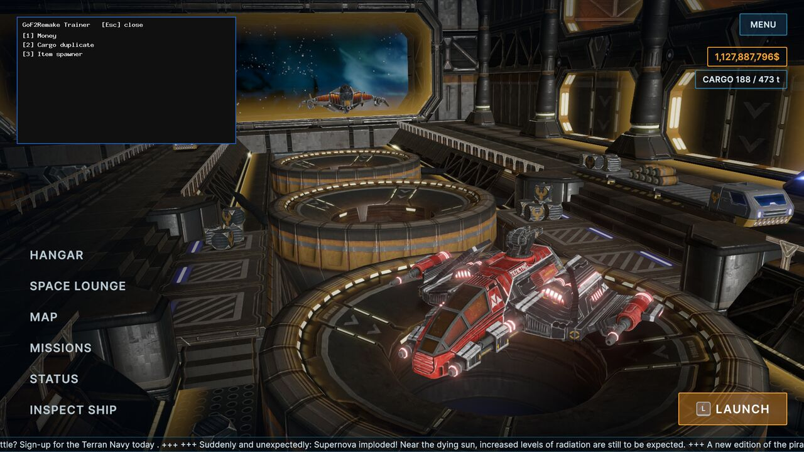
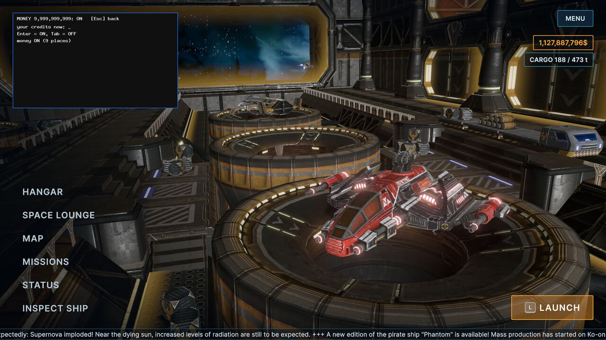
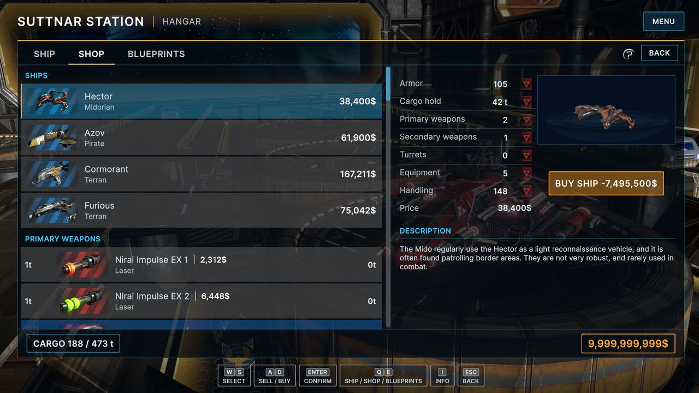
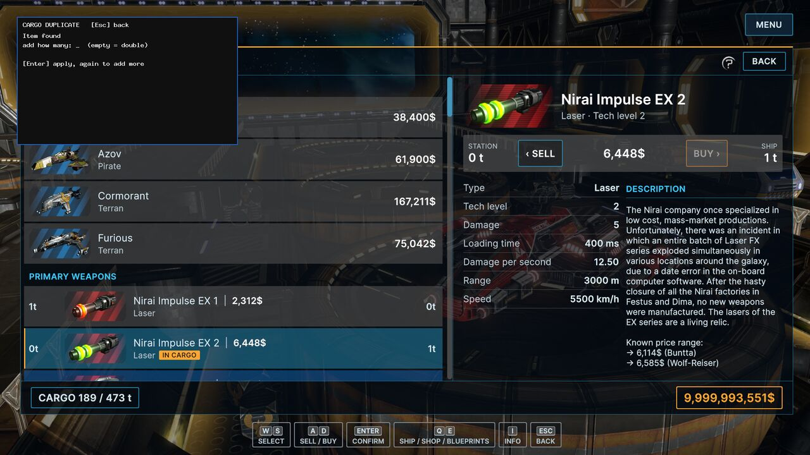
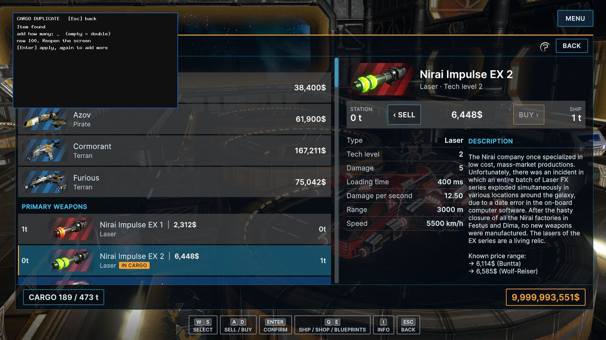
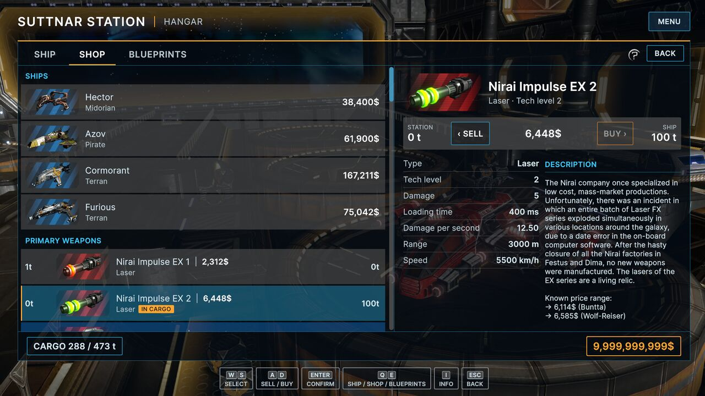
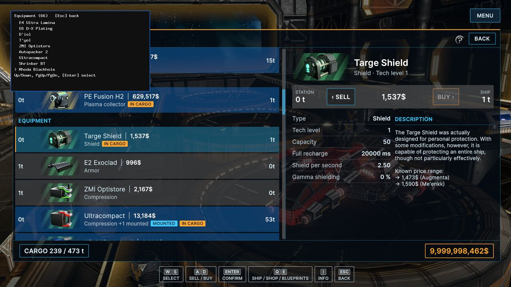
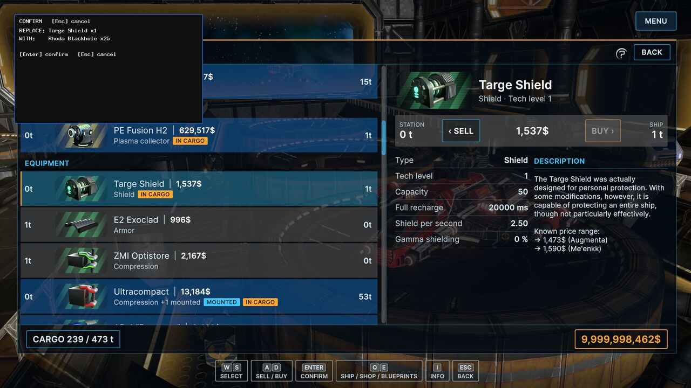
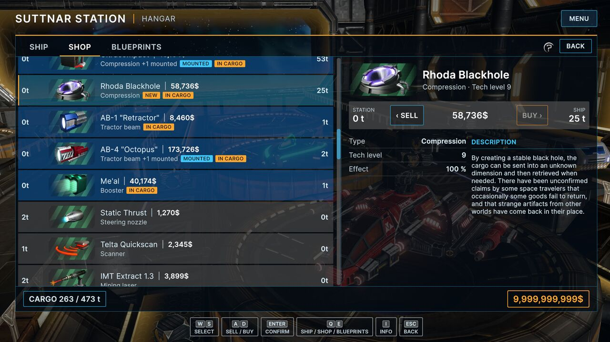

# GoF2Remake Trainer (Linux)

Trainer cheat menu for [Galaxy on Fire 2 Remake by JoppieToppie](https://github.com/JoppieToppie/Galaxy-on-Fire-2-Unity-Remake) on Linux (native Linux build, X11).

|                                          |                                              |                                             |
| ---------------------------------------- | -------------------------------------------- | ------------------------------------------- |
|          |            |         |
| F10 menu                                 | Money, type your credits                     | Credits at 9,999,999,999                    |
|  |      |   |
| Cargo duplicate, item found              | Add 99                                       | Ship cargo 1t -> 100t                       |
|    |  |  |
| Spawner, example Equipment list          | Confirm: replace Targe Shield                | Rhoda Blackhole x25 in cargo                |

Only for Linux, tested in Linux: Devuan GNU/Linux 6 (excalibur) x86_64

## Features

| Key | What                                                       |
| --- | ---------------------------------------------------------- |
| 1   | Money 9,999,999,999, kept there                            |
| 2   | Cargo duplicate: add to, or double, an item in your hold   |
| 3   | Item spawner: pick any of the 233 items by type and amount |

## Requirements

- Linux, Galaxy on Fire 2 Remake (native Linux build)
- X11 session (the menu does not work on pure Wayland)
- [mise](https://mise.jdx.dev)
- `~/.local/bin` in your PATH (or use the full path when you launch)

## Install

Install from source (Go 1.27+):

```sh
mise install-local
```

Writes `./dist/gof2remake-trainer`, auto install to `~/.local/bin/gof2remake-trainer`.

## Setup

The game must be started by the trainer (ptrace_scope=1 blocks attaching to a running game). Give the trainer the game command:

```sh
gof2remake-trainer ~/Games/PC/GoF2-Unity/GoF2Remake/GoF2Remake.x86_64
```

Or as a launch option (Steam, Heroic, Lutris, Bottles), before the command placeholder:

```
gof2remake-trainer %command%
```

"command not found"? Use the full path: `/home/USERNAME/.local/bin/gof2remake-trainer %command%`.

Start the game, load a save, press **F10**.

Launch option, mise may need its shims:

```
~/.local/share/mise/shims/gof2remake-trainer %command%
```

## Use

- **F10** opens and closes the menu. Press the number key of a line to open it, **Esc** goes back one level.
- Cheats only work after a save is loaded, not in the main menu.
- **Money (1):** type your current credits (the number on screen), Enter. Tab turns it off.
- **Cargo duplicate (2):** open the trade screen, click the item, type its ship amount, Enter. If other items share the amount, sell 1 of your item and buy it back, Enter each time, until it is found. Then type how many to add (empty = double). Click another item and back to refresh the screen.
- **Item spawner (3):** pick a type, an item and an amount. Then pick one cargo item of the same type that you can lose: it is replaced by the new item. Confirm.

## If something is wrong

- **F10 does nothing:** the launch option is wrong. Check `~/.cache/gof2remake-trainer.log`.
- **A cheat shows an error:** load a save first, then try again.
- **Money not found:** type the credits exactly as on screen, with no commas.

## Develop

    mise run build      # -> dist/gof2remake-trainer
    mise run vet
    mise run clean

Layout: `cmd/` entry point, `internal/trainer` memory scan and edits, `internal/ui` X11 menu. The item list is read from the game's own `resources.assets` at runtime.

## License

[MIT](LICENSE). This covers the trainer code. The screenshots contain material from Galaxy on Fire 2 Remake and belong to its owners, not covered by the MIT license.
